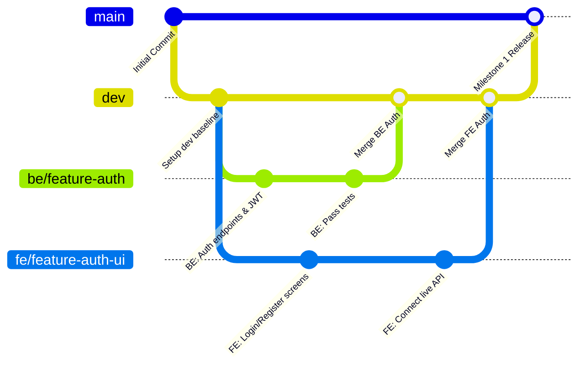
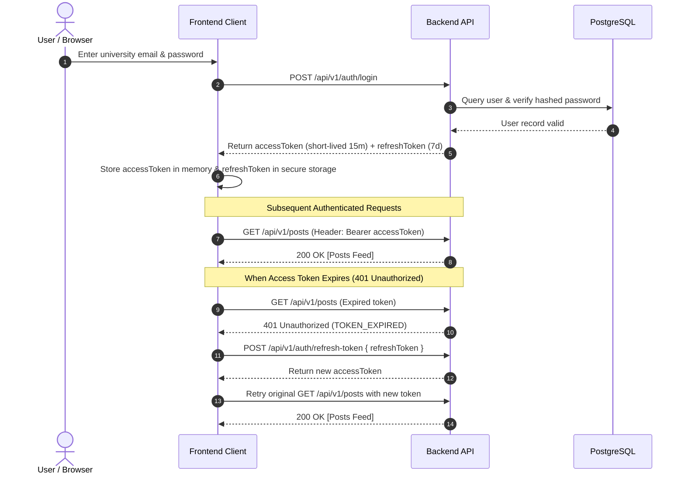

# Almaarefa Network — Frontend & Backend Parallel Development & Integration Plan

> **Document Version:** 1.0.0  
> **Target Audience:** Backend Developer & Frontend Developer  
> **Project:** Almaarefa Network (Graduation Project)  
> **Objective:** Establish strict API contracts, data schemas, development standards, Git workflows, and phased milestones to enable seamless concurrent development without integration conflicts.

---

## 1. Executive Summary & Core Philosophy

To build **Almaarefa Network** concurrently without collision, both developers must adhere to **Contract-First Development**:
1. **The API Contract is Immutable without Mutual Agreement:** Any change to an endpoint, request payload, query parameter, or response schema must be agreed upon by both developers before code is written.
2. **Decoupled Development via Mocking:** The frontend developer must never be blocked waiting for backend endpoints. Frontend builds against typed mock data (or Mock Service Worker) mirroring this document's exact JSON contracts.
3. **Single Source of Truth for Data Models:** All entities originate from the database schema (`schema.sql`) and are reflected directly in shared TypeScript interfaces.
4. **Clear Ownership Boundaries:**
   - **Backend:** Database schema migrations, business logic, authentication/authorization (RBAC), validation, file storage access, and API response performance.
   - **Frontend:** User experience (UX), responsive layouts (mobile-first), client-side state management, forms & client validation, API integration, and error presentation.

---

## 2. Recommended Repository & Directory Architecture

To keep code synchronized, use either a **Monorepo** (recommended for two students) or **Coordinated Polyrepos**.

### Recommended Monorepo Structure
```text
almaarefa-network/
├── .github/
│   └── workflows/              # CI/CD pipelines (linting, tests)
├── backend/                    # Backend API (Node.js/Express/NestJS or FastAPI)
│   ├── src/
│   │   ├── config/             # DB & env configuration
│   │   ├── modules/            # Domain modules (auth, users, courses, clubs, posts, moderation)
│   │   ├── middlewares/        # Auth, role check, error handler, rate limit
│   │   └── utils/
│   ├── database/
│   │   ├── schema.sql          # Base PostgreSQL schema
│   │   └── migrations/         # Database migrations
│   ├── tests/
│   ├── package.json
│   └── .env.example
├── frontend/                   # Frontend SPA/SSR (Next.js / React + TypeScript + Tailwind)
│   ├── src/
│   │   ├── app/                # Pages / Routes
│   │   ├── components/         # Reusable UI components (Atomic design)
│   │   ├── hooks/              # Custom React hooks (useAuth, usePosts, etc.)
│   │   ├── services/           # API client layer (Axios / Fetch instances)
│   │   ├── mocks/              # Mock Service Worker (MSW) or dummy data
│   │   ├── types/              # Frontend TypeScript definitions
│   │   └── utils/
│   ├── package.json
│   └── .env.example
├── shared/                     # Shared definitions (or symlinked/npm workspace)
│   └── types/                  # Shared TypeScript interfaces & DTOs
├── README.md
└── FRONTEND_BACKEND_INTEGRATION_PLAN.md
```

---

## 3. Git Workflow & Anti-Conflict Rules

### 3.1 Branching Strategy
* **`main`**: Production-ready code only. Direct commits are forbidden.
* **`dev`**: Main integration branch. All completed features are merged here.
* **Feature Branches**:
  - Backend features: `be/feature-<feature-name>` (e.g., `be/feature-auth`, `be/feature-clubs`)
  - Frontend features: `fe/feature-<feature-name>` (e.g., `fe/feature-auth-ui`, `fe/feature-clubs-feed`)
  - Shared/Contract fixes: `fix/api-<contract-change>`



### 3.2 Golden Collaboration Rules
1. **Never edit files in the other person's folder:**
   - Backend developer works inside `backend/` (and reviews `shared/types`).
   - Frontend developer works inside `frontend/` (and reviews `shared/types`).
2. **Pull `dev` daily:** Run `git pull origin dev` every morning before starting work.
3. **Atomic Pull Requests (PRs):** Keep PRs small and focused on a single feature or endpoint.
4. **Environment Variables via `.env.example`:** Never commit actual `.env` files with secret keys. Always update `.env.example` when a new configuration variable is introduced.

---

## 4. Universal API Standards & Conventions

All endpoints must conform to these standard formatting rules.

### 4.1 Base URL & Versioning
All backend APIs must be prefixed with:
```text
https://<domain_or_localhost>/api/v1
```

### 4.2 Casing Standard
* **URLs & Query Parameters:** `kebab-case` or lowercase with underscores (e.g., `/api/v1/class-groups?academic_year=2026`)
* **JSON Request & Response Bodies:** `camelCase`  
  *(Note: Even though PostgreSQL columns use `snake_case`, the backend serializer must convert keys to `camelCase` before sending to frontend, e.g., `user_id` $\rightarrow$ `userId`, `created_at` $\rightarrow$ `createdAt`)*.
* **Database Columns (PostgreSQL):** `snake_case` (as defined in `schema.sql`).
* **HTTP Headers:** `Kebab-Case` (e.g., `Authorization: Bearer <token>`).

### 4.3 Standard Success Response Envelope
Every successful response returns `success: true`:

#### Single Resource
```json
{
  "success": true,
  "data": {
    "userId": "9b1deb4d-3b7d-4bad-9bdd-2b0d7b3dcb6d",
    "universityEmail": "student@mcst.edu.sa",
    "role": "STUDENT"
  }
}
```

#### Paginated List
```json
{
  "success": true,
  "data": [
    { "id": "uuid-1", "title": "First Item" },
    { "id": "uuid-2", "title": "Second Item" }
  ],
  "meta": {
    "page": 1,
    "limit": 20,
    "totalCount": 85,
    "totalPages": 5,
    "hasNextPage": true,
    "hasPrevPage": false
  }
}
```

### 4.4 Standard Error Response Envelope
Every error must return `success: false` and a consistent format:
```json
{
  "success": false,
  "error": {
    "code": "VALIDATION_FAILED",
    "message": "Invalid university email format or credentials.",
    "details": [
      {
        "field": "universityEmail",
        "issue": "Email must belong to @mcst.edu.sa domain"
      }
    ]
  }
}
```

### 4.5 Standard HTTP Status Codes
| Code | Meaning | When to Use |
| :--- | :--- | :--- |
| **200 OK** | Success | Standard GET, PUT, or PATCH completion. |
| **201 Created** | Created | Resource successfully created (POST). |
| **204 No Content** | Deleted | Successful deletion with no body returned (DELETE). |
| **400 Bad Request** | Client error | Malformed syntax or invalid request format. |
| **401 Unauthorized** | Unauthenticated | Missing or expired JWT token. |
| **403 Forbidden** | Access denied | User is logged in but lacks necessary role (e.g., STUDENT accessing ADMIN route). |
| **404 Not Found** | Missing resource | The requested ID or route does not exist. |
| **409 Conflict** | Duplicate record | Unique constraint violation (e.g., email or student ID already taken). |
| **422 Unprocessable** | Validation error | Semantic validation failed (e.g., invalid email domain, password too short). |
| **500 Internal Error** | Server failure | Unhandled exceptions (never leak raw stack traces to the frontend). |

---

## 5. Complete API Endpoint Contracts

### 5.1 Authentication & Account Management

#### `POST /api/v1/auth/register`
* **Purpose:** Register new student account (Restricted to Almaarefa University domains).
* **Auth:** None (Public).
* **Request Body:**
```json
{
  "universityEmail": "s123456@mcst.edu.sa",
  "password": "StrongPassword123!",
  "fullName": "Turki Al-Harbi",
  "studentId": "202110234",
  "departmentId": "4a7b53e8-5d22-4e08-9df5-bc65476d05ea"
}
```
* **Response `201 Created`:**
```json
{
  "success": true,
  "data": {
    "userId": "9b1deb4d-3b7d-4bad-9bdd-2b0d7b3dcb6d",
    "universityEmail": "s123456@mcst.edu.sa",
    "role": "STUDENT",
    "emailVerified": false,
    "isVerified": false,
    "profile": {
      "fullName": "Turki Al-Harbi",
      "studentId": "202110234",
      "username": "s123456"
    }
  }
}
```

#### `POST /api/v1/auth/login`
* **Purpose:** Log in using university credentials.
* **Request Body:**
```json
{
  "universityEmail": "s123456@mcst.edu.sa",
  "password": "StrongPassword123!"
}
```
* **Response `200 OK`:**
```json
{
  "success": true,
  "data": {
    "accessToken": "eyJhbGciOiJIUzI1Ni...",
    "refreshToken": "eyJhbGciOiJIUzI1Ni...",
    "expiresIn": 3600,
    "user": {
      "userId": "9b1deb4d-3b7d-4bad-9bdd-2b0d7b3dcb6d",
      "email": "s123456@mcst.edu.sa",
      "role": "STUDENT",
      "isVerified": false,
      "profile": {
        "fullName": "Turki Al-Harbi",
        "username": "s123456",
        "avatarUrl": null,
        "departmentName": "Computer Science"
      }
    }
  }
}
```

#### `POST /api/v1/auth/refresh-token`
* **Purpose:** Refresh expired access token using refresh token.
* **Request Body:**
```json
{
  "refreshToken": "eyJhbGciOiJIUzI1Ni..."
}
```
* **Response `200 OK`:**
```json
{
  "success": true,
  "data": {
    "accessToken": "eyJhbGciOiJIUzI1Ni...",
    "expiresIn": 3600
  }
}
```

#### `GET /api/v1/auth/me`
* **Purpose:** Retrieve currently authenticated user context.
* **Auth:** Bearer Token.
* **Response `200 OK`:** Full user + profile object.

---

### 5.2 Student Profile & Verification

#### `GET /api/v1/profiles/:userId`
* **Purpose:** Fetch public student profile.
* **Auth:** Bearer Token.
* **Response `200 OK`:**
```json
{
  "success": true,
  "data": {
    "userId": "9b1deb4d-3b7d-4bad-9bdd-2b0d7b3dcb6d",
    "fullName": "Turki Al-Harbi",
    "username": "turki_cs",
    "avatarUrl": "https://storage.almaarefa.edu/avatars/user-123.png",
    "bio": "Senior Computer Science student passionate about AI and mobile dev.",
    "department": {
      "departmentId": "4a7b53e8-5d22-4e08-9df5-bc65476d05ea",
      "name": "Computer Science",
      "code": "CS"
    },
    "isVerified": true,
    "joinedAt": "2026-09-01T08:00:00.000Z"
  }
}
```

#### `PATCH /api/v1/profiles/me`
* **Purpose:** Update current student profile details.
* **Request Body:**
```json
{
  "fullName": "Turki K. Al-Harbi",
  "bio": "Updated bio text",
  "avatarUrl": "https://storage.almaarefa.edu/avatars/new.png"
}
```

#### `POST /api/v1/verification/submit`
* **Purpose:** Student submits verification proof (ID card image/document).
* **Auth:** Bearer Token.
* **Request Body:**
```json
{
  "submittedStudentId": "202110234",
  "proofDocumentUrl": "https://storage.almaarefa.edu/proofs/proof-uuid.jpg"
}
```
* **Response `201 Created`:**
```json
{
  "success": true,
  "data": {
    "requestId": "2e8c617c-02ef-457f-b52b-7be7df506bf4",
    "status": "PENDING",
    "submittedAt": "2026-11-12T13:45:00.000Z"
  }
}
```

---

### 5.3 Academic Structure & Class Groups

#### `GET /api/v1/departments`
* **Purpose:** List all university academic departments.
* **Auth:** Bearer Token.
* **Response `200 OK`:** Array of departments (`departmentId`, `name`, `code`, `description`).

#### `GET /api/v1/courses?departmentId=<uuid>`
* **Purpose:** List courses offered, optionally filtered by department.
* **Auth:** Bearer Token.

#### `GET /api/v1/class-groups`
* **Query Parameters:** `courseId` (optional), `semester` (e.g. `Fall 2026`), `page`, `limit`.
* **Response `200 OK`:** Paginated class groups with member counts.

#### `POST /api/v1/class-groups/:groupId/join`
* **Purpose:** Student joins a course discussion group.
* **Auth:** Bearer Token.
* **Response `200 OK`:** `{ "success": true, "message": "Successfully joined class group." }`

---

### 5.4 Student Clubs & Campus Events

#### `GET /api/v1/clubs`
* **Query Parameters:** `category`, `search`, `page`, `limit`.
* **Response `200 OK`:** List of active clubs (`clubId`, `name`, `category`, `description`, `logoUrl`, `membersCount`).

#### `POST /api/v1/clubs/request`
* **Purpose:** Submit proposal to form a new recognized student club.
* **Auth:** Bearer Token.
* **Request Body:**
```json
{
  "proposedName": "Google Developer Student Club (GDSC)",
  "category": "Technology",
  "description": "Empowering students through technology and hands-on workshops.",
  "proposalFileUrl": "https://storage.almaarefa.edu/proposals/gdsc-proposal.pdf"
}
```

#### `POST /api/v1/clubs/:clubId/join`
* **Purpose:** Student requests to join a club.
* **Response `201 Created`:** Join request queued with status `PENDING`.

#### `GET /api/v1/events`
* **Purpose:** Unified Campus Calendar feed.
* **Query Parameters:** `from` (ISO date), `to` (ISO date), `clubId` (optional).
* **Response `200 OK`:**
```json
{
  "success": true,
  "data": [
    {
      "eventId": "f512762a-ecff-4b31-90a8-b67dbec14331",
      "title": "Introduction to AI & Deep Learning Workshop",
      "description": "Interactive session covering AI fundamentals for beginners.",
      "club": {
        "clubId": "9b1deb4d-3b7d-4bad-9bdd-2b0d7b3dcb6d",
        "name": "AI & Robotics Club",
        "logoUrl": "https://storage.almaarefa.edu/clubs/ai.png"
      },
      "location": "Auditorium Hall B",
      "startTime": "2026-11-20T10:00:00.000Z",
      "endTime": "2026-11-20T12:30:00.000Z",
      "rsvpCount": 78,
      "hasRsvp": false
    }
  ]
}
```

---

### 5.5 Posts, Academic Collaboration & Comments

#### `GET /api/v1/posts`
* **Query Parameters:**
  - `feedType`: `general` | `class_group` | `club`
  - `targetId`: Group UUID or Club UUID (required when `feedType` is not `general`)
  - `page`: default 1
  - `limit`: default 10
* **Response `200 OK`:**
```json
{
  "success": true,
  "data": [
    {
      "postId": "d2a0d922-1264-42b7-a3cf-73fc34dcbeea",
      "author": {
        "userId": "9b1deb4d-3b7d-4bad-9bdd-2b0d7b3dcb6d",
        "fullName": "Sarah Al-Ghamdi",
        "username": "sarah_g",
        "avatarUrl": "https://storage.almaarefa.edu/avatars/sarah.jpg",
        "isVerified": true
      },
      "postType": "ACADEMIC",
      "content": "Does anyone have the past exam papers for Database Systems (CS312)?",
      "attachments": [
        {
          "type": "DOCUMENT",
          "url": "https://storage.almaarefa.edu/files/syllabus.pdf",
          "name": "CS312_Syllabus.pdf",
          "sizeBytes": 204850
        }
      ],
      "stats": {
        "likesCount": 14,
        "commentsCount": 6,
        "hasLiked": false
      },
      "createdAt": "2026-11-12T14:10:00.000Z"
    }
  ],
  "meta": {
    "page": 1,
    "limit": 10,
    "totalCount": 42,
    "totalPages": 5,
    "hasNextPage": true,
    "hasPrevPage": false
  }
}
```

#### `POST /api/v1/posts`
* **Purpose:** Create post in class group, club, or general feed.
* **Request Body:**
```json
{
  "postType": "GENERAL",
  "clubId": null,
  "classGroupId": "762f033a-d68a-4db3-a9d9-06395b2d5fc2",
  "content": "Here is the summary notes for Lecture 4.",
  "attachments": [
    {
      "type": "DOCUMENT",
      "url": "https://storage.almaarefa.edu/files/lecture4-summary.pdf",
      "name": "Lecture4_Summary.pdf"
    }
  ]
}
```

#### `POST /api/v1/posts/:postId/comments`
* **Request Body:**
```json
{
  "content": "Thank you so much! Really helpful."
}
```

#### `POST /api/v1/posts/:postId/reactions`
* **Request Body:**
```json
{
  "reactionType": "LIKE"
}
```

---

### 5.6 Content Moderation & Reporting

#### `POST /api/v1/reports`
* **Purpose:** One-click report by students flagging inappropriate content or spam.
* **Request Body:**
```json
{
  "postId": "d2a0d922-1264-42b7-a3cf-73fc34dcbeea",
  "reason": "SPAM",
  "description": "Unauthorized commercial advertising link posted."
}
```

#### `GET /api/v1/admin/reports` *(Admin Role Only)*
* **Query Parameters:** `status` (`PENDING`, `RESOLVED`, `DISMISSED`), `page`, `limit`.

#### `POST /api/v1/admin/moderation/action` *(Admin Role Only)*
* **Request Body:**
```json
{
  "reportId": "8b5f3a1e-8422-4876-b333-e0283fc37a11",
  "postId": "d2a0d922-1264-42b7-a3cf-73fc34dcbeea",
  "actionType": "DELETE_POST",
  "reason": "Violated campus community academic standards.",
  "suspendUser": false
}
```

---

## 6. Shared TypeScript Interfaces

Copy these definitions directly into the frontend project (`frontend/src/types/api.ts` or `shared/types/index.ts`).

```typescript
// ============================================================================
// SHARED TYPES FOR ALMAAREFA NETWORK
// ============================================================================

export type UserRole = 'STUDENT' | 'CLUB_LEADER' | 'FACULTY' | 'ADMIN';

export interface User {
  userId: string;
  universityEmail: string;
  role: UserRole;
  emailVerified: boolean;
  isVerified: boolean;
  isActive: boolean;
  createdAt: string;
}

export interface Profile {
  userId: string;
  departmentId?: string | null;
  studentId?: string | null;
  fullName: string;
  username: string;
  avatarUrl?: string | null;
  bio?: string | null;
  createdAt: string;
  updatedAt: string;
}

export interface Department {
  departmentId: string;
  name: string;
  code: string;
  description?: string | null;
}

export interface Course {
  courseId: string;
  departmentId: string;
  courseCode: string;
  courseName: string;
  creditHours: number;
}

export interface ClassGroup {
  groupId: string;
  courseId: string;
  courseCode?: string;
  courseName?: string;
  title: string;
  semester: string;
  academicYear: number;
  description?: string | null;
  status: 'ACTIVE' | 'ARCHIVED';
  membersCount?: number;
}

export interface Club {
  clubId: string;
  name: string;
  category: string;
  description?: string | null;
  logoUrl?: string | null;
  status: 'ACTIVE' | 'SUSPENDED';
  membersCount?: number;
}

export interface PostAttachment {
  type: 'IMAGE' | 'DOCUMENT';
  url: string;
  name: string;
  sizeBytes?: number;
}

export interface Post {
  postId: string;
  author: {
    userId: string;
    fullName: string;
    username: string;
    avatarUrl?: string | null;
    isVerified: boolean;
  };
  clubId?: string | null;
  classGroupId?: string | null;
  postType: 'GENERAL' | 'ACADEMIC' | 'CLUB_EVENT';
  content: string;
  attachments?: PostAttachment[];
  stats: {
    likesCount: number;
    commentsCount: number;
    hasLiked: boolean;
  };
  moderationStatus: 'APPROVED' | 'PENDING' | 'REJECTED';
  createdAt: string;
}

export interface CampusEvent {
  eventId: string;
  clubId: string;
  clubName: string;
  clubLogoUrl?: string | null;
  title: string;
  description: string;
  location: string;
  startTime: string;
  endTime: string;
  rsvpCount: number;
  hasRsvp: boolean;
}

export interface ApiResponse<T> {
  success: true;
  data: T;
  meta?: {
    page: number;
    limit: number;
    totalCount: number;
    totalPages: number;
    hasNextPage: boolean;
    hasPrevPage: boolean;
  };
}

export interface ApiErrorResponse {
  success: false;
  error: {
    code: string;
    message: string;
    details?: Array<{ field: string; issue: string }>;
  };
}
```

---

## 7. Authentication & Token Management Lifecycle



### Axios Client Interceptor Setup (Frontend)
To implement automatic token refresh without code duplication:
```typescript
// frontend/src/services/apiClient.ts
import axios from 'axios';

export const apiClient = axios.create({
  baseURL: process.env.NEXT_PUBLIC_API_URL || 'http://localhost:5000/api/v1',
  headers: { 'Content-Type': 'application/json' },
});

apiClient.interceptors.request.use((config) => {
  const token = localStorage.getItem('accessToken');
  if (token) {
    config.headers.Authorization = `Bearer ${token}`;
  }
  return config;
});

apiClient.interceptors.response.use(
  (response) => response,
  async (error) => {
    const originalRequest = error.config;
    if (error.response?.status === 401 && !originalRequest._retry) {
      originalRequest._retry = true;
      const refreshToken = localStorage.getItem('refreshToken');
      if (refreshToken) {
        try {
          const res = await axios.post(`${apiClient.defaults.baseURL}/auth/refresh-token`, { refreshToken });
          const newAccessToken = res.data.data.accessToken;
          localStorage.setItem('accessToken', newAccessToken);
          originalRequest.headers.Authorization = `Bearer ${newAccessToken}`;
          return apiClient(originalRequest);
        } catch (refreshErr) {
          localStorage.clear();
          window.location.href = '/login';
        }
      }
    }
    return Promise.reject(error);
  }
);
```

---

## 8. File Upload Strategy (Verification IDs & Attachments)

Avoid streaming large binary files directly through the application server memory.

### Presigned URL Flow:
1. **Frontend asks for upload ticket:**
   `POST /api/v1/uploads/presigned-url` with `{ fileName: "student-id.jpg", fileType: "image/jpeg", category: "verification" }`
2. **Backend validates file extension/size** and returns a presigned direct upload URL (Supabase Storage / AWS S3 / MinIO).
3. **Frontend uploads directly:** Sends PUT request with binary data to the storage bucket.
4. **Frontend submits reference:** Sends the clean public/storage URL to the verification endpoint (`proofDocumentUrl`).

---

## 9. Frontend Mocking Strategy (Parallel Unblocked Dev)

While the backend developer builds database tables, routes, and controllers, the frontend developer must not wait.

1. Create a mock handler layer using **Mock Service Worker (MSW)** or a typed local mock adapter:
   ```typescript
   // frontend/src/mocks/handlers.ts
   export const mockUser: User = {
     userId: '9b1deb4d-3b7d-4bad-9bdd-2b0d7b3dcb6d',
     universityEmail: 'student@mcst.edu.sa',
     role: 'STUDENT',
     emailVerified: true,
     isVerified: true,
     isActive: true,
     createdAt: new Date().toISOString()
   };
   ```
2. Toggle between live and mock API via a single environment variable:
   ```env
   # .env.local
   NEXT_PUBLIC_USE_MOCK=true # Set to false once backend endpoint is ready
   ```
3. Switching to production requires **zero changes to UI components**—only flipping the environment variable.

---

## 10. Synchronized Milestone Roadmap (Sprint by Sprint)

| Sprint / Week | Backend Deliverables (User) | Frontend Deliverables (Partner) | Joint Integration Goal |
| :--- | :--- | :--- | :--- |
| **Week 1: Foundations** | • Setup DB from `schema.sql`<br>• Setup Express/FastAPI boilerplate<br>• Auth endpoints (Register/Login/JWT)<br>• CORS & middleware | • Setup Next.js/React + Tailwind<br>• Setup router & auth state<br>• Login & Register UI pages<br>• Configure Axios client & mock data | **Integration Gate 1:** User can register, log in, persist token, and see dashboard shell. |
| **Week 2: Profiles & Verification** | • Profile CRUD endpoints<br>• Verification submission & status endpoints<br>• Presigned URL upload service | • Profile viewing and editing page<br>• Verification document upload form<br>• Verification badge & status indicators | **Integration Gate 2:** Student can update profile and upload student ID for verification. |
| **Week 3: Academic Groups** | • Departments & courses endpoints<br>• Class groups creation & search<br>• Membership join/leave logic | • Academic directory page<br>• Class group list & filter by semester<br>• Group room layout & member list | **Integration Gate 3:** Student can browse courses and join official class groups. |
| **Week 4: Feeds & Discussions** | • Post CRUD (General & Group feeds)<br>• Comments & Likes endpoints<br>• Attachment URL metadata handling | • Feed component with tabs (Campus / Class / Club)<br>• Post composer modal with file uploader<br>• Comment thread & reaction buttons | **Integration Gate 4:** Real-time posting, reading, commenting, and liking in feeds. |
| **Week 5: Clubs & Events Calendar** | • Club requests & approval API<br>• Club profile & member management<br>• Campus event publishing & calendar API | • Clubs directory & Club page<br>• Club creation request form<br>• Interactive Campus Event Calendar (Monthly/Weekly view) | **Integration Gate 5:** Clubs publish events; students see events on calendar and RSVP. |
| **Week 6: Moderation & Admin Dashboard** | • One-click report endpoint<br>• Admin moderation dashboard API<br>• Deletion & audit logging triggers | • Report modal on posts<br>• Admin moderation panel (review flags, take action)<br>• Audit log table view | **Integration Gate 6:** Inappropriate post flagged by student, reviewed & deleted by Admin. |
| **Week 7: Polish, E2E Testing & Defense Prep** | • Rate limiting, security audit<br>• Error logging & DB indexes verification<br>• Backend load/performance testing | • Responsive UI audit (mobile/tablet/desktop)<br>• Skeleton loaders & empty state illustrations<br>• Arabic localization (i18n) scaffolding | **Final Gate:** Full end-to-end rehearsal for project presentation and grading. |

---

## 11. Pre-Merge Integration Checklist

Before declaring any feature complete:
- [ ] **Contract Verification:** Does the request body and response structure match the JSON examples in this guide?
- [ ] **CORS Configured:** Backend allows requests from `http://localhost:3000` (frontend local port) with credentials enabled.
- [ ] **Error Handling:** Backend returns standard `{ success: false, error: { ... } }` and frontend displays readable toast/alert.
- [ ] **Data Types:** No `any` types used across API service calls.
- [ ] **Status Codes:** Endpoints return semantic status codes (`201` for creation, `401` for auth failure, etc.).
- [ ] **Empty States Handled:** Frontend UI displays a graceful message when lists (posts, clubs, events) are empty.
- [ ] **Loading States:** Frontend buttons show spinner during asynchronous calls to prevent double submission.

