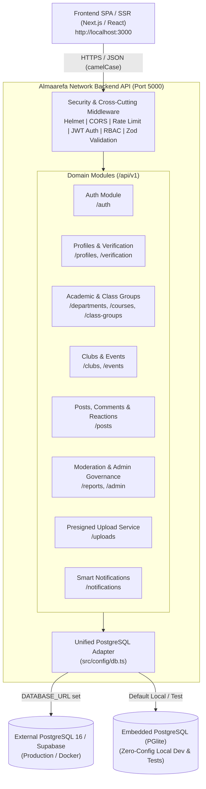
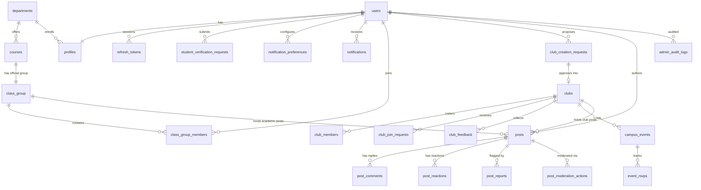

# Almaarefa Network — Backend Architecture, Technical Decisions & Database Specification

## 1. Architectural Overview

The **Almaarefa Network** backend is designed as a **Modular Service-Oriented Monolith** built on **Node.js**, **Express**, **TypeScript**, and **PostgreSQL**. This architecture satisfies the graduation project's non-functional requirements for maintainability, security, and future scalability (such as AI recommendation modules or LMS read-only sync) without introducing microservice operational overhead.

---

## 2. Key Technical & Architectural Decisions

### 2.1 Technology Stack Selection
| Layer | Technology | Rationale |
| :--- | :--- | :--- |
| **Runtime & Language** | Node.js + TypeScript (Strict) | Enables direct sharing of TypeScript interfaces (`shared/types/index.ts`) between Frontend and Backend, eliminating contract drift. |
| **HTTP Framework** | Express.js | Lightweight, battle-tested, and explicitly recommended in `FRONTEND_BACKEND_INTEGRATION_PLAN.md`. |
| **Database** | PostgreSQL (`pg` + `@electric-sql/pglite`) | Executes standard PostgreSQL 13+ DDL (`schema.sql`), foreign keys, `JSONB`, and `ILIKE` search. Dual-mode adapter supports both external PostgreSQL/Supabase (`pg.Pool`) and zero-setup embedded PostgreSQL (`PGlite`). |
| **Validation** | Zod | Declarative schema validation that maps field-level errors directly into the contract's `422 VALIDATION_FAILED` `details: [{ field, issue }]` format. |
| **Authentication** | JWT (`jsonwebtoken`) + `bcryptjs` | Short-lived access tokens (`1 hour` / `3600s`) paired with stateful, revocable refresh tokens (`7 days`) stored as SHA-256 hashes in `refresh_tokens`. |
| **Testing** | Vitest + Supertest | Fast, isolated integration testing against an in-memory PostgreSQL instance running the exact production SQL migrations. |

### 2.2 Casing & Serialization Boundary
- **Database Layer (`snake_case`):** All PostgreSQL tables and columns follow `snake_case` as established in `schema.sql` (`user_id`, `university_email`, `created_at`).
- **API Layer (`camelCase`):** All JSON request and response payloads use `camelCase` (`userId`, `universityEmail`, `createdAt`).
- **Query Parameter Resilience:** Endpoints accept both `camelCase` and `snake_case` query parameters (e.g., `departmentId` or `department_id`, `academicYear` or `academic_year`, `feedType` or `feed_type`) so frontend calls never fail due to query naming conventions.

### 2.3 Defensive Contract Compatibility
Where minor differences existed between Section 5 examples and Section 6 TypeScript interfaces in `FRONTEND_BACKEND_INTEGRATION_PLAN.md`, the backend provides **both shapes simultaneously**:
- **Login & `/auth/me` User Object:** Includes both `email` (Section 5.1) and `universityEmail` (Section 6 `User` interface).
- **Campus Events (`GET /api/v1/events`):** Includes both the nested `club: { clubId, name, logoUrl }` object (Section 5.4) and top-level `clubId`, `clubName`, `clubLogoUrl` fields (Section 6 `CampusEvent` interface).
- **Presigned Uploads (`POST /api/v1/uploads/presigned-url`):** Returns both `publicUrl` and `fileUrl` pointing to the uploaded asset.

---

## 3. Database Schema & Entity-Relationship Architecture

### 3.1 Migration Structure
The database schema is managed through sequential SQL migrations in `backend/database/migrations/`:
1. **[001_base_schema.sql](../database/migrations/001_base_schema.sql):** The exact base schema from root `schema.sql` (13 core tables: `departments`, `courses`, `users`, `profiles`, `student_verification_requests`, `class_group`, `class_group_members`, `club_creation_requests`, `clubs`, `club_members`, `club_join_requests`, `posts`, `post_reports`, `post_moderation_actions`, `admin_audit_logs`).
2. **[002_complete_platform_schema.sql](../database/migrations/002_complete_platform_schema.sql):** Non-destructive `ALTER TABLE` and `CREATE TABLE IF NOT EXISTS` extensions required to fulfill all functional requirements:
   - `users.password_hash` and `refresh_tokens` table for authentication & token revocation.
   - `profiles.academic_year` for student academic year tracking.
   - `posts.class_group_id`, `posts.content`, and `posts.attachments` (`JSONB`) for unified relational post storage.
   - `post_comments` and `post_reactions` for academic thread discussions and likes.
   - `campus_events` and `event_rsvps` for the Unified Campus Event Calendar.
   - `club_feedback` for student club ratings and anonymous feedback.
   - `notifications` and `notification_preferences` for the Smart Notification System.
   - `upload_tickets` for presigned file upload validation and tracking.

### 3.2 Entity-Relationship Diagram

---

## 4. Role-Based Access Control (RBAC) Matrix

| Capability / Endpoint Group | `STUDENT` | `CLUB_LEADER` | `FACULTY` | `ADMIN` |
| :--- | :---: | :---: | :---: | :---: |
| Register (`@mcst.edu.sa`), Login, Refresh Token | ✅ | ✅ | ✅ | ✅ |
| View & Update Own Profile, Submit ID Verification | ✅ | ✅ | ✅ | ✅ |
| Browse Departments, Courses, Class Groups, Join/Leave Groups | ✅ | ✅ | ✅ | ✅ |
| Create Courses & Official Class Groups | ❌ | ❌ | ✅ | ✅ |
| Create Posts, Comment, React, Search Feeds, Report Posts | ✅ | ✅ | ✅ | ✅ |
| Propose New Club, Request to Join Club, Submit Club Feedback | ✅ | ✅ | ✅ | ✅ |
| Update Club Info, Approve Club Join Requests, Publish Events | *(If Club Officer)* | ✅ *(Own Club)* | *(If Club Officer)* | ✅ *(All Clubs)* |
| Review Student Verifications & Club Creation Proposals | ❌ | ❌ | ❌ | ✅ |
| Review Flagged Post Reports, Delete Posts, Suspend Users, View Audit Logs | ❌ | ❌ | ❌ | ✅ |

---

## 5. Remaining Tasks & Known Limitations

1. **External SMTP / Push Notification Delivery:**
   - **Current State:** In-app notifications and user notification preferences (`emailNotifications`, `pushNotifications`, `threadReplies`, `clubEvents`, `campusAnnouncements`) are fully persisted and queryable via `/api/v1/notifications`.
   - **Future Production Step:** Connect `NotificationsService.createNotification` to an external SMTP provider (e.g., SendGrid / AWS SES) or Firebase Cloud Messaging (FCM) when university SMTP credentials are provided.
2. **Cloud Object Storage (S3 / Supabase Storage) Presigning:**
   - **Current State:** `/api/v1/uploads/presigned-url` implements the complete 2-step presigned `PUT` contract locally, storing files in `backend/uploads/` and serving them at `http://localhost:5000/uploads/*`.
   - **Future Production Step:** Swap the local ticket URL generator with `@aws-sdk/s3-request-presigner` or `@supabase/storage-js` in production deployment without changing the frontend integration code.
3. **University Single Sign-On (SSO) / Academic Portal Live Sync:**
   - **Current State:** University identity is enforced via `@mcst.edu.sa` domain validation on registration plus student ID card verification workflow (`/api/v1/verification/submit` + Admin approval).
   - **Future Production Step:** Integrate with Almaarefa University's LDAP/SAML SSO and read-only SIS course feed when institutional API access is granted.

